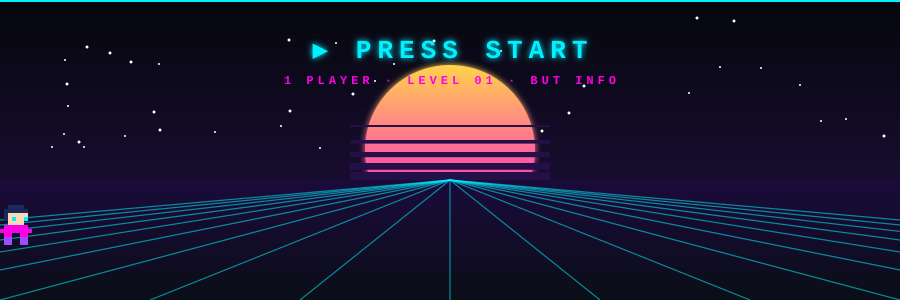
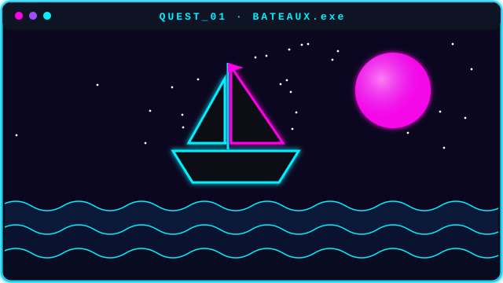
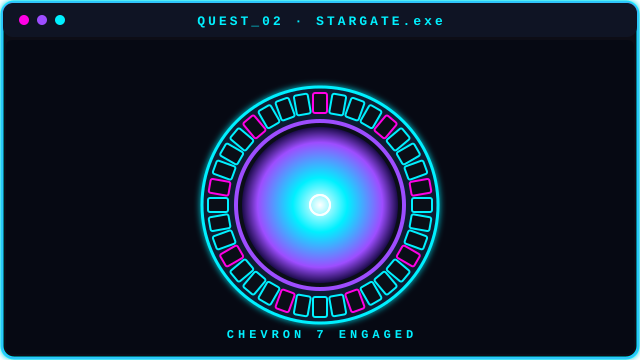
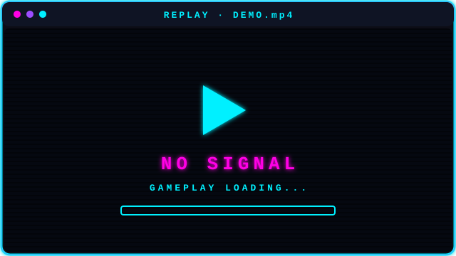

<!-- ═══════════════ HEADER ═══════════════ -->
<div align="center">


<a href="https://github.com/LilianusItsMe">
  
</a>

<br/>


<br/>



</div>


## 🕹️ PLAYER 1 — Sélection du personnage

<div align="center">


<table>
<tr>
<td align="center" valign="middle" width="240">


<br/>


</td>
<td valign="middle">

```text
┌─────────────────────────────────────────────┐
│ ▶ LILIANUS                         LVL 09   │
│ CLASSE  : Game Dev en formation             │
│ GUILDE  : BUT Informatique (2ère année)     │
│ SPAWN   : France                            │
├─────────────────────────────────────────────┤
│ HP         ██████████  100                  │
│ XP         ████░░░░░░   40  -> LVL 10       │
│ Mana       ███████░░░   70                  │
│ Strenght   ██████░░░░   60                  │
│ SPEED      █████░░░░░   60                  │
│ MOTIVATION ██████████  MAX                  │
├─────────────────────────────────────────────┤
│ QUÊTE EN COURS : Recherche De Stage         │
└─────────────────────────────────────────────┘
```

</td>
</tr>
</table>

</div>


## 🎒 Inventaire

### ⚔️ Langages

<p>
  
  
  
  
  
  
  
</p>

### 🎮 Moteurs de jeu *(en exploration)*

<p>
  
  
  
</p>

### 🧰 Outils

<p>
  
  
  
</p>


## 🎯 Objectif de la partie

> **Travailler dans le développement de jeux vidéo.**

J'explore **Godot** et **Unity** (GDScript / C#), la logique de gameplay, et j'adore construire des mécaniques de jeu *from scratch*.
Chaque projet est un niveau de plus vers cet objectif. 🚀


## 📜 Journal de quêtes

### 🚢 QUÊTE 01 — Site & réservations de trajets en bateau du CAN
`✅ TERMINÉE`

<table>
<tr>
<td width="48%" valign="middle">



</td>
<td valign="middle">

Création d'un **système de réservation en C#** pour des trajets en bateau reliant différentes îles de Bretagne, connecté à un **site web** permettant de consulter sa réservation et d'obtenir plus d'infos.

> 🏆 **Butin :** les bases du C#, HTML, CSS et JavaScript

   

</td>
</tr>
</table>

<br/>

### 🌀 QUÊTE 02 — Projet Stargate
`✅ TERMINÉE`

<table>
<tr>
<td width="48%" valign="middle">



</td>
<td valign="middle">

Application destinée à la **base secrète de la série Stargate** : créer des missions, consulter leurs infos, celles des différentes planètes, des races alliées et ennemies, etc. Fonctionne **en mode connecté et déconnecté**.

> 🏆 **Butin :** une solide maîtrise des WinForms de Visual Studio

 

</td>
</tr>
</table>

<br/>

### 🃏 QUÊTE 03 — Remake du jeu Inscryption
`✅ TERMINÉE`

<table>
<tr>
<td width="48%" valign="middle">



</td>
<td valign="middle">

Recréation d'une partie du jeu **Inscryption en Java**, jouable en **mode texte**, avec classes abstraites, classes normales, enums, interfaces, etc.

> 🏆 **Butin :** une énorme progression dans les bases du Java

 

</td>
</tr>
</table>

<br/>

### 🔒 QUÊTE 04 — ???
`⏳ EN COURS DE CHARGEMENT...` — mon premier vrai jeu sous Godot arrive bientôt.


## 🎬 Replays

<div align="center">



</div>


## 📬 Rejoindre ma partie

<div align="center">

<a href="https://discord.com/users/lilianuuus">
  
</a>

<br/><br/>

`🎮 PRESS START TO COLLAB 🎮`


</div>
